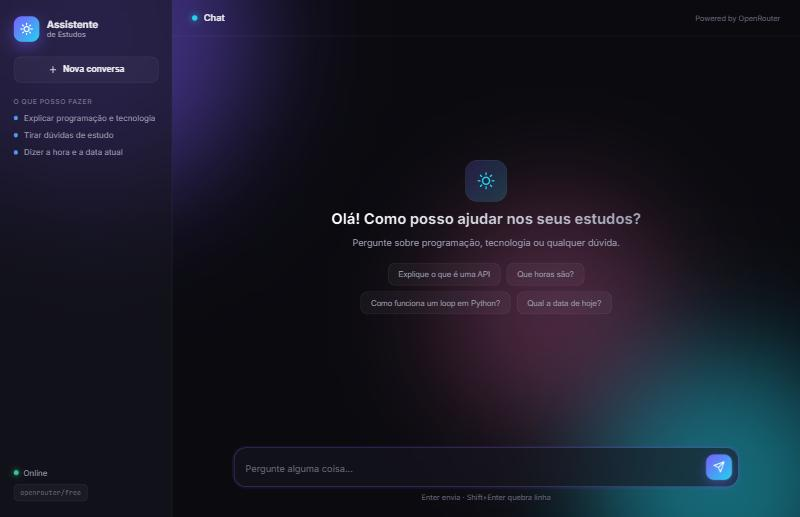

# 🤖 Assistente de Estudos

Um chatbot de estudos com interface web moderna, construído em **Python + Flask** e
conectado à **OpenRouter**. O agente responde dúvidas de programação e tecnologia e
possui ferramentas para informar a **hora** e a **data** atuais.

  



## ✨ Recursos

- Interface de chat moderna (tema escuro, gradientes, animações, responsiva)
- Renderização de Markdown e blocos de código nas respostas
- Ferramentas da IA: hora atual e data atual
- Histórico de conversa por sessão
- **Chave de API protegida no servidor** (nunca exposta no navegador)

## 🚀 Como rodar

1. Instale as dependências:
   ```bash
   pip install -r requirements.txt
   ```

2. Configure a chave de API:
   ```bash
   # Copie o exemplo e edite o .env com sua chave da OpenRouter
   copy .env.example .env    # Windows
   # cp .env.example .env    # Linux / macOS
   ```
   Pegue sua chave em https://openrouter.ai/keys

3. Inicie o servidor:
   ```bash
   python app.py
   ```

4. Abra no navegador: **http://localhost:5000**

## 🗂️ Estrutura

```
proj agente/
├── app.py              # Servidor Flask + lógica do agente
├── proj.agente.py      # Versão original em linha de comando (CLI)
├── templates/
│   └── index.html      # Página do chat
├── static/
│   ├── style.css       # Estilos
│   └── app.js          # Lógica do front-end
├── requirements.txt
├── .env.example
├── .gitignore
└── README.md
```

## ⚙️ Variáveis de ambiente

| Variável             | Descrição                              | Padrão            |
|----------------------|----------------------------------------|-------------------|
| `OPENROUTER_API_KEY` | Sua chave da OpenRouter (obrigatória)  | —                 |
| `OPENROUTER_MODEL`   | Modelo usado                           | `openrouter/free` |
| `FLASK_SECRET_KEY`   | Chave secreta das sessões (opcional)   | gerada automática |

## ☁️ Deploy online (gratuito no Render)

O projeto já vem pronto para publicar no [Render](https://render.com) usando o
arquivo [`render.yaml`](render.yaml).

1. Crie uma conta gratuita no Render (pode entrar com o GitHub).
2. No painel, clique em **New → Blueprint**.
3. Conecte este repositório. O Render lê o `render.yaml` automaticamente.
4. Em **Environment**, preencha a variável `OPENROUTER_API_KEY` com sua chave.
5. Clique em **Apply / Create** e aguarde o build. No fim, você recebe uma URL pública.

> Observação: no plano gratuito o serviço "dorme" após um tempo sem uso e
> leva alguns segundos para acordar no primeiro acesso.

## 📝 Licença

MIT
